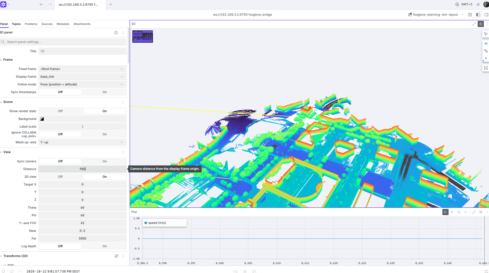
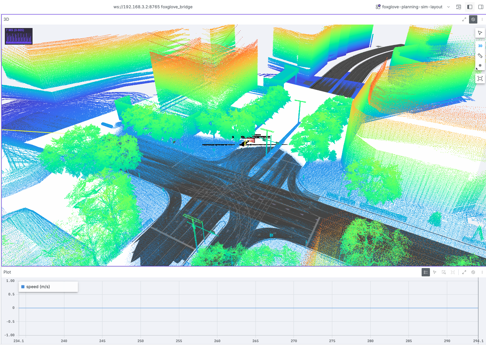

# meta-autoware

Builds the [Autoware](https://autoware.org) autonomous driving stack with Yocto instead of
Docker. Autoware runs on ROS 2 Jazzy, cross-compiled into a regular embedded Linux image,
with no GPU needed.

The layer itself is in [`meta-autoware/`](meta-autoware/README.md). This page covers the kas
setup used to build and test it.





## Branches

| Branch | Yocto release | Status |
|---|---|---|
| `master` | wrynose (6.0) | development |
| `wrynose` | wrynose (6.0) | stable |
| `scarthgap` | scarthgap (5.0) | stable |

On each branch, CI builds `core-image-autoware` for qemuarm64 and boots it under QEMU.

## What runs

- `core-image-autoware` starts Autoware nodes under QEMU on qemuarm64.
- The planning simulator demo runs on a Raspberry Pi 5 with 8 GB of RAM, leaving about 4 GB
  free. See [doc/raspberrypi5.md](doc/raspberrypi5.md). It has been tested on scarthgap
  only; the wrynose Pi 5 build is not tested yet.

## Requirements

- A Linux build host, x86-64 or aarch64, with about 250 GB of free disk and 16 GB of RAM.
  Build on the host and flash the board; don't build on the board.
- The usual Yocto host packages: `gcc`, `g++`, `make`, `git`, `wget`, `cpio`, `diffstat`,
  `chrpath`, `rsync`, `file`.
- `kas` and `pexpect`: `pip install --user kas pexpect`

## Build

```sh
kas build kas/qemuarm64.yml                        # ROS 2 base image
kas build kas/autoware.yml                         # Autoware image
kas build kas/raspberrypi5.yml                     # Autoware image for the Pi 5
kas build kas/raspberrypi5.yml:kas/demo.yml        # planning simulator demo for the Pi 5
```

A first build takes hours. `kas/cache.yml` keeps downloads and sstate in `yocto-cache/`, next
to the build directory, and pulls from the public Yocto sstate mirror. `kas/autoware.yml`
runs two tasks at `-j 2`, which fits in 16 GB. One pcl source file needs about 6 GB on its own.

## Test

Run the checks inside a kas shell so `runqemu` can find BitBake:

```sh
kas shell kas/qemuarm64.yml -c "python3 tools/boot-test.py qemuarm64"
kas shell kas/autoware.yml -c "python3 tools/boot-test.py qemuarm64 --image core-image-autoware"
```

The first one checks that a talker and a listener exchange messages on `ros-image-core`.
The second one starts `autoware_simple_pure_pursuit` and waits for its control command topic.
CI runs both on a self-hosted aarch64 runner; see `.github/workflows/`.

To boot the Autoware image yourself:

```sh
kas shell kas/autoware.yml -c 'runqemu core-image-autoware nographic slirp qemuparams="-m 4096 -smp 4"'
```

Log in as `root` (no password), then run `. /opt/ros/jazzy/setup.sh`.

## Layout

| Path | Contents |
|---|---|
| `kas/` | build configs; Yocto release pins are in `kas/releases/` |
| `meta-autoware/generated-recipes/` | recipes generated by `ros-mash`; never edit them by hand |
| `meta-autoware/classes/autoware-fixups.bbclass` | fixes applied to the generated recipes |
| `meta-autoware/recipes-thirdparty-bbappends/` | patches and fixes for specific packages |
| `meta-autoware/recipes-core/` | images and packagegroups |
| `meta-autoware/recipes-demo/` | the planning simulator demo and its map |
| `meta-autoware/PACKAGES.list` | packages taken from the generator output, written by `tools/rollout.sh` |
| `doc/` | Pi 5 notes and screenshots |
| `tools/` | recipe generation, `boot-test.py` for the QEMU checks, `ci-host-check.sh` for the CI runner |
| `results/` | generator logs, failure taxonomy and the list of skipped packages, per Autoware version |

## Regenerate the recipes

`generated-recipes/` is the output of one command:

```sh
kas checkout kas/autoware.yml      # the OE layers, to check recipe name collisions
tools/rollout.sh --ros-distro jazzy --autoware-ref 2.0.0
tools/run-mash-devtools.sh 0.8.5   # foxglove_bridge, outside autoware.repos
tools/sync-generated-recipes.sh devtools-0.8.5 meta-autoware/PACKAGES-devtools.list
tools/categorize-packages.py && tools/generate-tier1-packagegroups.py
```

It needs Ubuntu 24.04 with ROS 2 Jazzy, or Docker or Podman. The `ros-mash` version, the
rosdistro commit for rosdep and the container image are pinned in `tools/mash-pins.sh`, so the
same Autoware version gives the same recipes. Every package left out is listed with its reason
in `results/universe-<version>/skipped-packages.json`. `--no-mash` reuses the last generator
output, for when only the class or the scripts changed.

## Contributing

Open a pull request against `master` and sign off every commit (`git commit -s`). Fixes for
a release branch go to `master` first and are then cherry-picked.

## License

The layer metadata is MIT; see [LICENSE](LICENSE). Packages keep their upstream licenses.
The Shinjuku map in the demo image is CC BY-NC, so the demo image is for non-commercial use
only.
