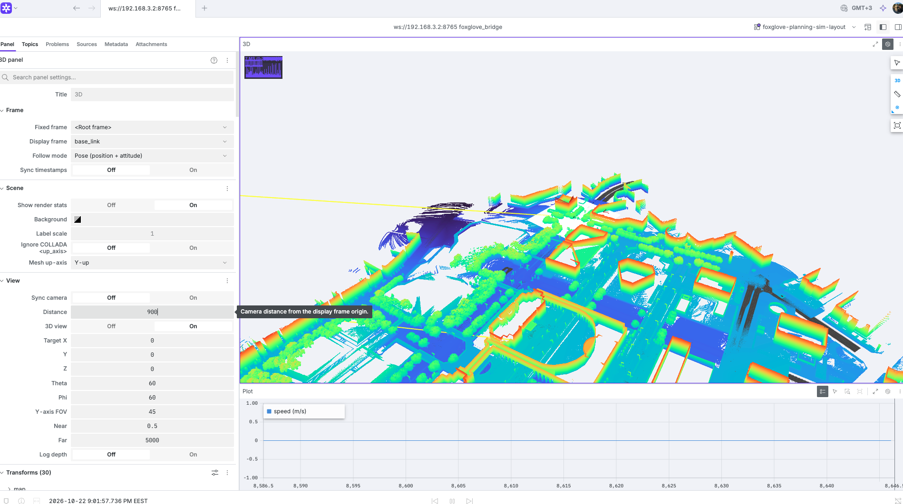
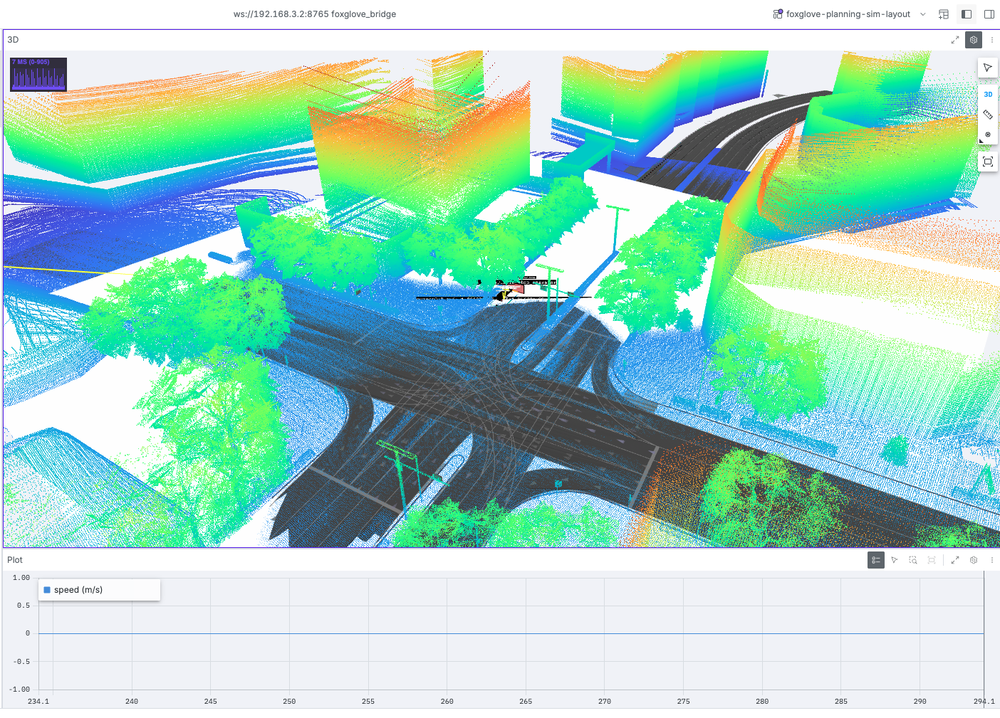

# meta-autoware

Building the Autoware autonomous driving stack with Yocto/OpenEmbedded instead of Docker.
ROS 2 Jazzy on scarthgap, GPU-free, cross-compiled. 

**Status:** `core-image-autoware` (243 Autoware packages) builds for qemuarm64 and runs
Autoware nodes under qemu. The Autoware demo also runs on a **Raspberry Pi 5 (8 GB)** with
**~4 GB RAM free** — see the [Demo](#demo-raspberry-pi-5-8-gb) section below.





## Demo: Raspberry Pi 5 (8 GB)

The Autoware demo runs on a Raspberry Pi 5 with 8 GB of RAM, leaving roughly 4 GB free.
No GPU, no Docker — the stack is cross-compiled with Yocto and booted on the board.

- Images: [`doc/Screenshot1.png`](doc/Screenshot1.png), [`doc/Screenshot2.png`](doc/Screenshot2.png)
- Log in as `root` (no password) and `. /opt/ros/jazzy/setup.sh`.

## Prerequisites

- Linux x86-64 or aarch64 build host (cross-compiling; never build on the target board
  itself), 250 GB free disk, 16 GB RAM, the usual Poky host packages
  (`gcc`, `g++`, `make`, `git`, `wget`, `cpio`, `diffstat`, `chrpath`, `rsync`, `file`).
- `kas` and `pexpect`: `pip install --user kas pexpect`

## Build

ROS 2 base image:
```sh
kas build kas/qemuarm64.yml
```

Autoware image:
```sh
kas build kas/autoware.yml
```

A cold build takes hours. `kas/cache.yml` keeps downloads and sstate in `yocto-cache/` next
to the build directory and uses the public Yocto sstate mirror. `kas/autoware.yml` limits
bitbake to 2 tasks × `-j 2`, which fits a 16 GB host.

> **Note:** the layer's bbappends (fixes to `ceres-solver`, `proxsuite`, `sophus`,
> `range-v3`, `gtest-vendor`, `joy`, `pcl-ros`, `tl-expected`, `septentrio-gnss-driver`,
> `tinyxml2-vendor`, `rosx-introspection`) are opt-in: they only apply when `autoware` is in
> `DISTRO_FEATURES`. `kas/autoware.yml` enables it. The layer stays inert for every other
> build, which is what `yocto-check-layer` expects.

## Test

```sh
python3 tools/boot-test.py qemuarm64                                # talker/listener on ros-image-core
python3 tools/boot-test.py qemuarm64 --image core-image-autoware    # Autoware node starts
```

Run them inside `kas shell kas/autoware.yml -c "..."` so `runqemu` finds bitbake.

To use the Autoware image by hand:
```sh
kas shell kas/autoware.yml -c "runqemu $PWD/build/tmp-glibc/deploy/images/qemuarm64/core-image-autoware-jazzy-qemuarm64.rootfs.qemuboot.conf nographic slirp qemuparams=\"-m 4096 -smp 4\""
```
Log in as `root` (no password) and `. /opt/ros/jazzy/setup.sh`.

CI runs both checks on a self-hosted runner, see `.github/workflows/`.

## Layout

- `kas/` — build configs; release pins in `kas/releases/`
- `meta-autoware/` — the layer
  - `generated-recipes/` — recipes generated by `ros-mash`, never edited by hand
  - `classes/autoware-fixups.bbclass` — fixes applied to generated recipes by content
  - `recipes-thirdparty-bbappends/` — fixes for specific upstream recipes or sources
  - `recipes-core/` — packagegroups and images
- `doc/` — screenshots of the Pi 5 demo
- `tools/` — `boot-test.py` runs the qemu checks, `ci-host-check.sh` checks the CI runner

## License

Layer metadata is MIT (see [LICENSE](LICENSE)). Packages keep their upstream licenses.
The Shinjuku map used in the demo is **CC BY-NC** — demo images only, non-commercial.